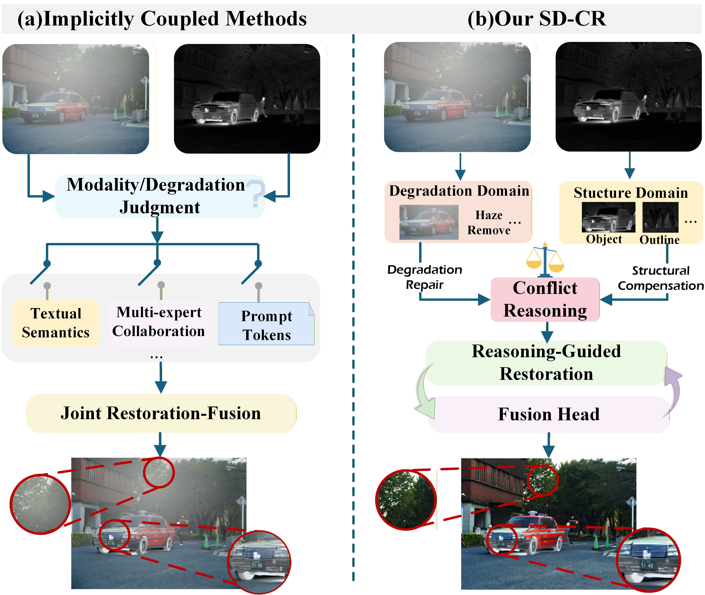
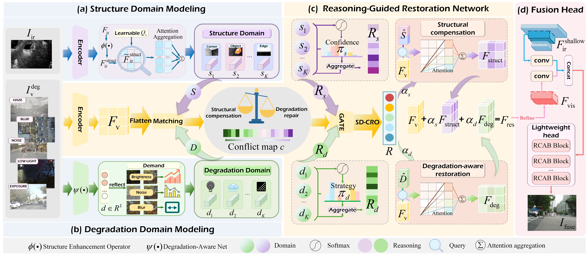
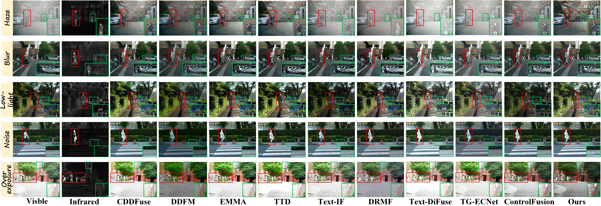
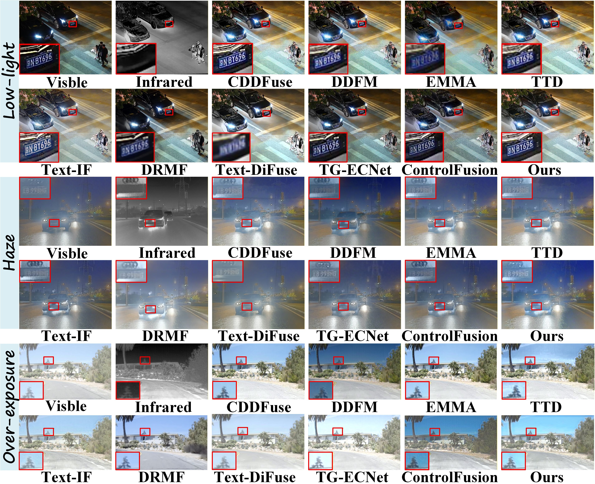
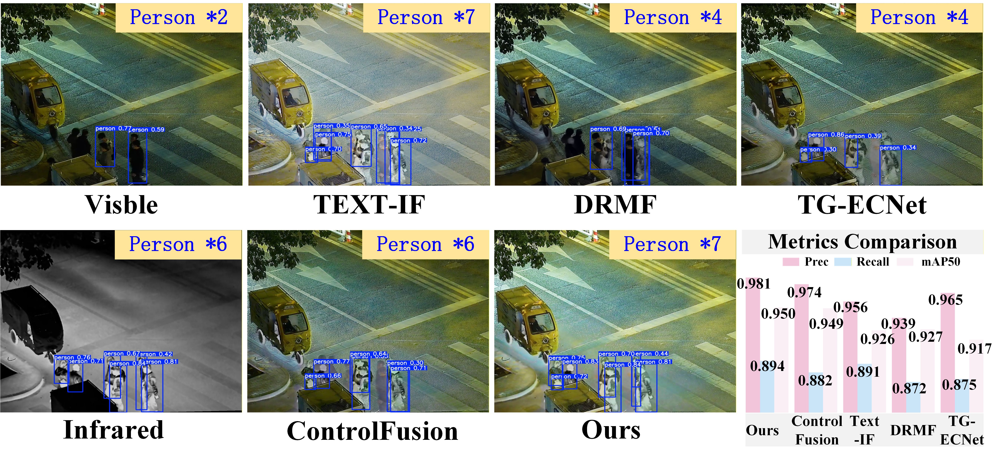
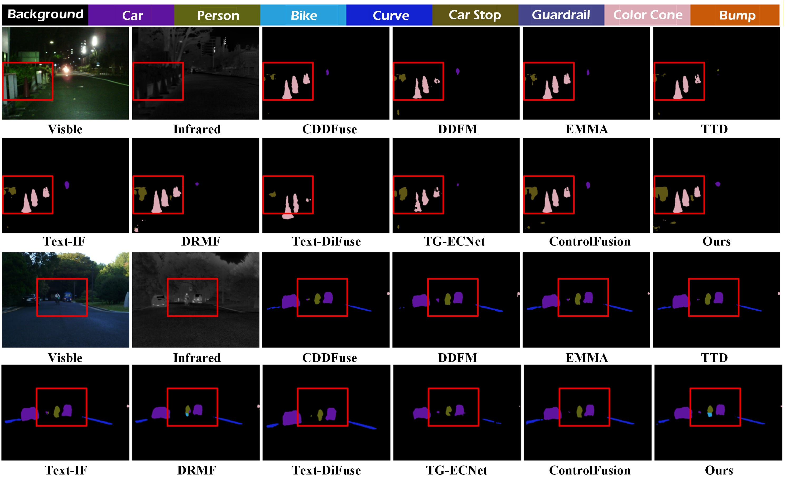

<div align="center">

<h1>SD-CR [Information Fusion 2026]</h1>
<h3>Structure–Degradation Co-Reasoning for Infrared–Visible Image Fusion<br>under Asymmetric Degradation</h3>

<p>
  Xiaosa Wang<sup>1</sup> &nbsp;·&nbsp;
  Huafeng Li<sup>1,†</sup> &nbsp;·&nbsp;
  Wen Wang<sup>2,†</sup> &nbsp;·&nbsp;
  Yafei Zhang<sup>1</sup> &nbsp;·&nbsp;
  Yu Liu<sup>3</sup> &nbsp;·&nbsp;
  Xiangbo Shu<sup>4</sup>
</p>

<p>
  <sup>1</sup>Kunming University of Science and Technology &nbsp;&nbsp;
  <sup>2</sup>Yunnan University<br>
  <sup>3</sup>Hefei University of Technology &nbsp;&nbsp;
  <sup>4</sup>Nanjing University of Science and Technology<br>
  <sup>†</sup>Corresponding authors
</p>

<p>
  <a href="https://github.com/bi8bo121/SD-CR"></a>
  <a href="https://pan.baidu.com/s/1peWQgwwDZ91zKZOTU_ZCaw?pwd=1jpv"></a>
  <a href="#citation"></a>
</p>

</div>

<a id="method-overview"></a>

## 🔎 Method Overview

### Motivation

<p align="center">
  <a href="assets/motivation.jpg"></a>
</p>

### Framework

<p align="center">
  <a href="assets/framework.jpg"></a>
</p>

<a id="installation"></a>

## 🔧 Environment Setup

```bash
git clone https://github.com/bi8bo121/SD-CR.git
cd SD-CR
conda create -n sdcr python=3.10 -y
conda activate sdcr
python -m pip install -r requirements.txt
```

Use a PyTorch/torchvision installation compatible with your CPU or CUDA platform.

<a id="checkpoints"></a>

## 📥 Pretrained Models

Download from **[Baidu Netdisk](https://pan.baidu.com/s/1peWQgwwDZ91zKZOTU_ZCaw?pwd=1jpv)**. Extraction code: **`1jpv`**.

For inference, place the Stage 3 checkpoint at `stage3_results/stage3_ep027.pth`.

<a id="inference-and-evaluation"></a>

## 🧪 Inference

Place paired images with matching filenames in `datasets/example/ir/` and `datasets/example/vis/`, then run:

```bash
python test.py \
  --stage3_ckpt stage3_results/stage3_ep027.pth \
  --dataset_root datasets/example \
  --ir_dir ir --vis_dir vis \
  --dataset_name example \
  --results_root outputs/evaluation
```

<a id="training"></a>

## 🚂 Training

```bash
# Stage 1: visible image restoration
python stage1.py --data-root datasets/DDL

# Stage 2: image fusion
python stage2.py --data-root datasets/DDL \
  --stage1-ckpt checkpoints_l1_balanced_5types/restoration_epoch_150.pt

# Stage 3: fine-tuning
python stage3.py --data-root datasets/DDL \
  --stage1-ckpt checkpoints_l1_balanced_5types/restoration_epoch_150.pt \
  --stage2-ckpt stage2_results_fresh/stage2_ep120_full.pth
```

<a id="results"></a>

## 📷 Fusion Results

### Five Degradation Scenarios

<p align="center">
  <a href="assets/fusion-comparison.jpg"></a>
</p>

### Real-World Degraded Scenes

<p align="center">
  <a href="assets/realworld-comparison.jpg"></a>
</p>

<a id="downstream-tasks"></a>

## 🎯 Downstream Tasks

### Object Detection

<p align="center">
  <a href="assets/object-detection.jpg"></a>
</p>

### Semantic Segmentation

<p align="center">
  <a href="assets/semantic-segmentation.jpg"></a>
</p>

<a id="citation"></a>

## 🎓 Citation

If you find this work useful, please consider citing:

```bibtex
@article{wang2026sdcr,
  title   = {Structure--Degradation Co-Reasoning for Infrared--Visible Image Fusion under Asymmetric Degradation},
  author  = {Wang, Xiaosa and Li, Huafeng and Wang, Wen and Zhang, Yafei and Liu, Yu and Shu, Xiangbo},
  journal = {Information Fusion},
  year    = {2026}
}
```

## 🤝 Contact

[wangxiaosa@stu.kust.edu.cn](mailto:wangxiaosa@stu.kust.edu.cn)
